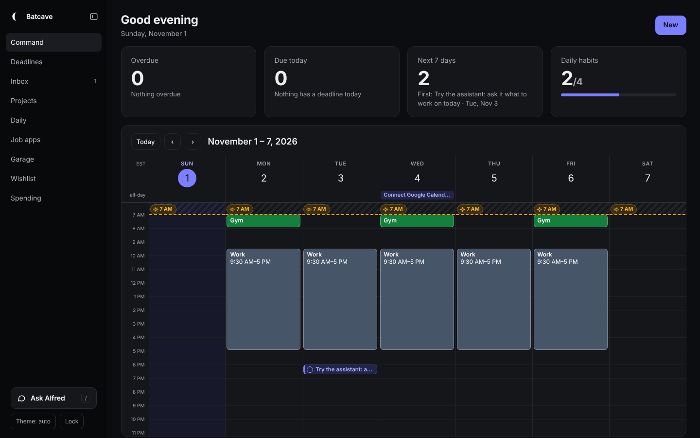

# Batcave

A personal command center you host yourself: tasks and deadlines, a Google-Calendar-style week view with
two-way Google Calendar sync, daily and weekly habits, wake-up times, a wishlist, a garage log, and a
chat assistant (a polite butler named Alfred by default) that can read and change all of it.

It runs on Cloudflare Workers + D1 (the free plan is enough), has no build step, and is locked behind your own
password. Name it, rename the assistant, and set your time zone in one config file.



## What you get

- **Command page** built from widgets: overdue, due today, next 7 days, daily habits, calendar, date, projects, focus, garage.
  Choose **Settings → Edit home screen** (or hold a widget on a phone) to customize it like an iPhone home screen:
  drag to rearrange, pick Small / Medium / Large, remove with −, or use **+ Add widget** in the bar that pops up.
  The calendar widget shows your next events (small), the rest of today (medium) or the full week (large); the date
  widget shows today like the iPhone's, with the month in medium and large. The layout is saved to your account.
- **Settings** (bottom-left, or More on a phone): theme, home screen editing, sidebar, and Lock.
- **Week calendar** you edit like Google Calendar: drag events to move them, drag the bottom edge to resize,
  click or drag on empty space to create, click an event for a details card. Changes go straight to Google
  Calendar. Tasks with a time sit in the grid too (tick to finish, drag to reschedule).
- **Wake-up line** on every day (drag to change one day; click to set a weekday or the default).
- **Projects page**: click **Edit** to add or delete projects. Deleting hides the project, keeps its tasks, and supports Undo / Redo.
- **Daily page**: daily habits, weekly habits (done once each Sunday–Saturday week) and their history.
- **Assistant** (bottom-left, press `/`): "what's overdue?", "move my dentist appointment to Friday at 3",
  "add laundry as a weekly habit". It uses OpenAI with tools over your data; it adds and changes, never permanently deletes.
  Give it a vague to-do and it picks a sensible time from your free slots.
- **To-do API**: send a sentence from a phone shortcut or script; the assistant files it and answers.
- **Sessions**: send in the transcript of a work or study session (a chat with an AI tool, a coding-agent run);
  it's summarized into a short session note, matched to the right note, and handed to your notes app through a
  small bridge (for example an Obsidian vault on your computer).
- **Undo everywhere** with ⌘Z / Ctrl+Z, and an **iPhone** layout you can add to your home screen.

## Quick start

You need [Node.js 20+](https://nodejs.org) and a free [Cloudflare account](https://dash.cloudflare.com/sign-up).

```bash
git clone https://github.com/23alcor/batcave.git
cd batcave
npm install
npm run setup
```

`npm run setup` asks for your name, the dashboard and assistant names, your time zone and (optionally) a
domain. It then creates the D1 database, writes `wrangler.jsonc`, creates the tables, offers some example data,
deploys, and sets your login password. At the end, open the URL it printed and sign in.

Everything personal lives in files git ignores (`wrangler.jsonc`, `.env`, `.dev.vars`, `.site-password`), so you
can pull updates without conflicts.

## Settings

In `wrangler.jsonc` → `vars` (template: [`wrangler.example.jsonc`](wrangler.example.jsonc)). Run `npm run deploy`
after changing them.

| Var | What it does | Default |
| --- | --- | --- |
| `APP_NAME` | Name in the sidebar, page titles, login page and home-screen icon | `Batcave` |
| `OWNER_NAME` | Your first name ("Good evening, Sam") | empty |
| `OWNER_FULL_NAME` | Shown on the public `/privacy` page | `OWNER_NAME` |
| `ASSISTANT_NAME` | The assistant's name ("Ask Alfred") | `Alfred` |
| `HONORIFIC` | How the assistant addresses you | `sir` |
| `TIMEZONE` | IANA time zone used for every date and time | `America/New_York` |
| `TAGLINE` | Optional line under the sidebar's assistant button | empty |
| `CONTACT_EMAIL` | Optional contact on `/privacy` | empty |
| `OPENAI_MODEL`, `OPENAI_REASONING` | Assistant model and reasoning effort | `gpt-6.1-terra`, `low` |

Secrets are set with `npx wrangler secret put NAME` and never stored in the repo:

| Secret | For |
| --- | --- |
| `PASSWORD_HASH`, `SESSION_SECRET` | Login (set by `npm run set-password`) |
| `OPENAI_API_KEY` | The assistant |
| `INGEST_TOKEN` | The to-do API, the Alfred command API and the Sessions API |
| `GOOGLE_CLIENT_ID`, `GOOGLE_CLIENT_SECRET` | Google Calendar sync |

## Keyboard shortcuts

| Key | Does |
| --- | --- |
| `N` or `⌘K` | New task / inbox item / event |
| `/` | Open the assistant |
| `⌘Z` / `⇧⌘Z` | Undo / redo the last change |
| `⌘B` | Hide or show the sidebar |
| `Esc` | Close a card, or finish editing the Command page |
| `←` `→` | While editing the Command page: move the focused widget (`Delete` removes it) |

On iPhone: open the site in Safari → Share → **Add to Home Screen**.

## The assistant

Set an OpenAI key (a [project key](https://platform.openai.com/api-keys) with a monthly budget is a good idea):

```bash
npx wrangler secret put OPENAI_API_KEY
```

It uses the OpenAI Responses API with about two dozen tools over your data (projects, tasks, calendar, habits, wake-up times,
wishlist, garage). Conversation history stays in your browser tab. Its personality is a dry-witted English
butler; the name and how it addresses you come from your settings.

## Alfred command API

`POST /api/ingest/alfred` accepts questions and commands with the same tools as the in-site chat,
including adding, renaming, deleting (archiving), and restoring projects. Authenticate with the existing
`INGEST_TOKEN`. Send plain text or JSON `{"text":"..."}` (`message` also works).
Each request is independent; include enough context to identify the item. Alfred can ask for clarification
when a request is ambiguous. Questions, unsupported commands, and errors are never saved as inbox tasks.

```bash
curl -X POST "https://YOUR_SITE/api/ingest/alfred?format=text" \
  -H "Authorization: Bearer $INGEST_TOKEN" \
  -H "Content-Type: application/json" \
  -d '{"text":"Rename my Robotics project to Senior Design"}'
```

Without `?format=text`, responses contain `{handled_by, reply, actions, changed}` (or `error` on failure).
This endpoint requires `OPENAI_API_KEY`; if unavailable it returns an error instead of adding a task.
The to-do API below keeps its existing inbox fallback.

## To-do API

Send a to-do from anywhere. The assistant files it (inbox, a dated task in a free slot, a calendar event, a habit…)
or carries it out ("mark the lab report done"), and its answer comes back.

```bash
curl -X POST "https://YOUR_SITE/api/ingest/todo?format=text" \
  -H "Authorization: Bearer $INGEST_TOKEN" \
  -d "pick up printer ink tomorrow afternoon"
# Added "Pick up printer ink" for Sat, Oct 31 at 2:00 PM, sir.
```

- Body: plain text, or JSON `{"text": "...", "notes"?, "due_at"?: "YYYY-MM-DD[THH:MM]", "url"?, "source"?}`
  (`title`, `name` or `task` also work in place of `text`).
- `?format=text` returns just the sentence (good for a shortcut's notification); without it you get JSON
  `{handled_by, reply, actions}`. `?alfred=0` skips the assistant and saves straight to the inbox.
- Nothing is lost: if the assistant is unavailable, the text is saved to the inbox as written.
- `npm run setup` can create the token (saved to `.env`), or: `npx wrangler secret put INGEST_TOKEN`.

**Apple Shortcuts**: *Ask for Input* → *Get Contents of URL* (method POST, header `Authorization: Bearer <token>`,
JSON body `text` = Provided Input, URL ending in `?format=text`) → *Show Notification* with the result. Don't share
the shortcut file; it contains your token.

## Sessions (transcripts → your notes)

Send the transcript of a work or study session. The assistant's model writes a short session note (summary, what
changed, decisions and next steps for work; what was covered, key ideas, what's unclear and what to review for
study), labels what kind of session it was (call, interview, meeting, lecture, coding, study, research, writing,
planning or other), picks the note it belongs to, and the **Sessions** page shows it. A notes bridge on your computer then
collects the ready ones and writes them into your notes app.

```bash
curl -X POST "https://YOUR_SITE/api/ingest/transcripts?source=codex" \
  -H "Authorization: Bearer $INGEST_TOKEN" \
  --data-binary @session.txt
# {"id":"…","status":"new"}
```

- Body: plain text, or JSON `{"transcript": "...", "source"?, "title"?, "target"?, "kind"?: "work" | "study",
  "started_at"?, "ended_at"?: "YYYY-MM-DDTHH:MM"}`. In plain-text mode the same fields work as URL parameters.
  Up to 1.5 MB per transcript. You can also paste one on the Sessions page.
- It's summarized right away when it can be; anything still waiting is picked up by the bridge, the optional
  cron in `wrangler.example.jsonc`, or **Retry** on the Sessions page. Needs `OPENAI_API_KEY`.
- The model never copies passwords, keys or tokens into the summary. The full transcript is always kept and
  handed to the bridge along with the summary.

**Bridge API** (same `INGEST_TOKEN`):

| Request | Does |
| --- | --- |
| `PUT /api/ingest/transcripts/targets` | `{"targets": [{"name", "kind"?, "hint"?}], "rules"?: "..."}`: the notes a session can belong to, and extra rules for the model |
| `GET /api/ingest/transcripts?status=ready` | Summaries waiting to be saved (`status` takes a comma list: new, summarizing, ready, filed, error, dismissed) |
| `GET /api/ingest/transcripts/:id` | One session with its transcript |
| `POST /api/ingest/transcripts/:id/summarize` | Summarize one that is waiting, and return it |
| `POST /api/ingest/transcripts/:id/filed` | `{"path"?}`: it was saved to your notes |

## Google Calendar (two-way)

Optional. Without it, the week view shows the weekly schedule stored in the `events` table (or a read-only
calendar feed: `npx wrangler secret put GCAL_ICS_URL` with your calendar's secret iCal address).

1. In [Google Cloud Console](https://console.cloud.google.com), create a project and enable the **Google Calendar API**.
2. **OAuth consent screen**: External. Add your email as a test user, add the scopes
   `.../auth/calendar.events` and `.../auth/calendar.calendarlist.readonly`, and set the privacy policy URL to
   `https://YOUR_SITE/privacy` (the app serves it). Then **Publish app** → In production, so the sign-in doesn't
   expire after 7 days. You don't need Google's verification for your own account; you'll just see an
   "unverified app" warning once (Advanced → continue).
3. **Credentials** → Create OAuth client ID → Web application → authorized redirect URI
   `https://YOUR_SITE/api/google/callback`.
4. Save the client id and secret:
   ```bash
   npx wrangler secret put GOOGLE_CLIENT_ID
   npx wrangler secret put GOOGLE_CLIENT_SECRET
   ```
5. On the dashboard's week view, click **Connect Google Calendar**. **Calendars** picks which calendars show;
   **Disconnect** revokes access.

The refresh token is stored encrypted in D1 (AES-GCM, key derived from `SESSION_SECRET`). Repeating events are
edited one occurrence at a time.

## Import from Notion (optional)

`scripts/import-notion.mjs` pulls tasks, projects, an inbox, a garage and a wishlist from Notion
databases. Copy `scripts/notion.config.example.json` to `scripts/notion.config.json`, fill in your data source ids,
and check the property names at the top of each section match yours. Then:

```bash
NOTION_TOKEN=ntn_xxx npm run import:notion
npx wrangler d1 execute batcave --remote --file seed/notion-import.sql
```

## Local development

```bash
npm run db:migrate:local
npm run db:examples:local                # optional sample data
npx wrangler dev --var DEV_BYPASS:1      # skips the login locally
# or: npm run set-password -- --local && npm run dev
```

Put local-only secrets (like `OPENAI_API_KEY`) in `.dev.vars`.

## Updating

```bash
git pull
npm install
npm run db:migrate   # new tables/columns, if any
npm run deploy
```

## Security

- One password protects everything: PBKDF2-SHA256, a signed HttpOnly session cookie (30 days), and an IP lockout
  after 8 wrong tries in 15 minutes. Until a password is set, every page stays locked.
- Cross-site writes are refused. The only public paths are `/login`, `/privacy`, the icons and app manifest, and the
  to-do API (which needs `INGEST_TOKEN`).
- Change the password with `npm run set-password` (or `-- --generate` for a random passphrase saved to
  `.site-password`). Changing it signs out every device.

## Project layout

```
src/worker.js      API routes, login, to-do API, wake-up times, habits
src/chat.js        The assistant: OpenAI Responses API tool loop
src/google.js      Google Calendar OAuth + two-way sync
src/calendar.js    Weekly schedule expansion + iCal parsing
src/auth.js        Password check, session cookie, lockout, login page
src/config.js      Your settings (from wrangler.jsonc vars)
public/            The app (vanilla JS + CSS, no build step)
migrations/        D1 schema
scripts/           setup, set-password, Notion import
examples/          Sample data for a new install
```

## License

[MIT](LICENSE). Make it yours.
